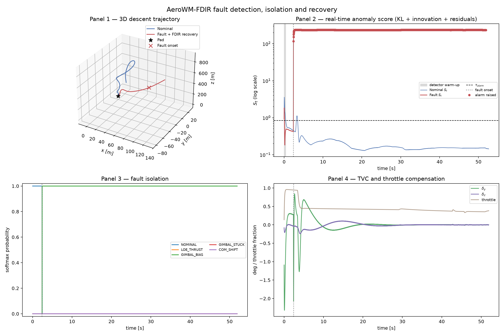

# AeroWM-FDIR

**Latent world-model control with real-time fault detection, isolation and
recovery (FDIR) for 6-DOF powered descent.**

[](https://github.com/Shushant17711/AeroWM-FDIR/actions/workflows/ci.yml)
[](https://www.python.org/)
[](https://pytorch.org/)
[](LICENSE)
[](LIMITATIONS.md)

> **Research software for a simulated vehicle.**  Everything in this repository
> runs inside a GPU-vectorised 6-DOF simulator.  It is published so that the
> measurements can be inspected and reproduced.  It is not flight software —
> see [`LIMITATIONS.md`](LIMITATIONS.md) for exactly what is and is not
> claimed.



---

## Abstract

Fault-tolerant guidance for a powered-descent vehicle needs three things at
once: a *detector* that notices an actuator or propulsion fault within a
couple of control steps, an *isolator* that says which subsystem failed, and
a *controller* that keeps the vehicle inside the landing envelope while the
compensation is applied.  This repository implements that stack end to end in
a differentiable simulator and measures it:

* a recurrent state-space latent **world model** (RSSM with TD-MPC2 heads)
  that supplies a fault-conditioned context and a refinement policy;
* an **exact one-step physics-residual detector** (actuator tracking, thrust
  tracking, rigid-body rate residual, 2-sample confirmed frozen-servo test)
  feeding a **5-way isolator** whose decision is latched per episode;
* a **fault-conditioned classical control law** (Section 6.3 terminal divert,
  ACS takeover of a frozen gimbal axis, saturation-aware tilt limiting) plus
  a **bounded learned residual**, and a latent **MPPI** variant of the same
  stack.

On the published benchmark (20 episodes per fault mode, deterministic seed)
the detector alarms **2.00 steps (40 ms)** after the onset with **100 %
detection**, **96-100 % isolation** and a **0 % false-alarm rate** on nominal
flights, and the FDIR stack lands **90-100 %** of the faulted flights where a
non-adaptive cascaded-PID reference lands **0-10 %**.  The full measurement
trail, including the numbers that did *not* work, is in
[`results/TRAINING_REPORT.md`](results/TRAINING_REPORT.md).

---

## 1. Headline results

`python -m eval.benchmark_fdir --episodes 20 --fast-mppi` — 20 episodes per
fault mode, 8 parallel environments, seed 0, onset 150, severity 0.35 (LOE) /
0.5 (others).  Artefact: [`results/eval_results.json`](results/eval_results.json).

| controller | nominal | LOE thrust | gimbal bias | gimbal stuck | CoM shift |
| :-- | --: | --: | --: | --: | --: |
| `Cascaded-PID` (non-adaptive reference) | 100 % | 5 % | 0 % | 0 % | 10 % |
| `PPO (model-free residual)` | 95 % | 50 % | 0 % | 5 % | 5 % |
| **`AeroWM-FDIR (actor)`** | **100 %** | **95 %** | **90 %** | **90 %** | **100 %** |
| **`AeroWM-FDIR (MPPI)`** | **90 %** | **100 %** | **95 %** | **95 %** | **90 %** |

The classical reference is **non-adaptive** and is not told the fault: it
lands 100 % of the nominal flights and 0-10 % of the faulted ones.  The
`GIMBAL_STUCK` mode has no benign freezes left in the fault model (a TVC
that seizes within a fraction of a degree of the vertical does not degrade
the flight, so it is not a fault — see
[`LIMITATIONS.md`](LIMITATIONS.md) §2).

**Detection and isolation** (same run; `scripts/check_fdir.py` reproduces it
standalone):

| controller | LOE | bias | stuck | CoM | mean latency | isolation | false alarms |
| :-- | --: | --: | --: | --: | --: | --: | --: |
| actor | 2.0 | 2.0 | 2.0 | 2.0 | **2.00 steps (40 ms)** | **96.2 %** | **0 %** |
| MPPI | 2.0 | 2.0 | 2.0 | 2.0 | **2.00 steps (40 ms)** | **100 %** | **0 %** |

Detection is 100 % in every fault mode for both controllers.

**Verification gates**

| gate | requirement | measured | verdict |
| :-- | :-- | :-- | :-- |
| 1 — physics throughput | SPS ≥ 200 k | **267 915** (full env, B = 1024; 262-278k across runs) | ✅ |
| 2 — classical reference | nominal ≥ 90 %, faults ≤ 50 % (**≤ 30 %**) | 100 % nominal, worst fault 10 % | ✅ |
| 3 — real-time FDIR | latency ≤ 3 steps, isolation ≥ 92 % | 2.00 steps (40 ms), 96-100 % isolation, 0 % false alarms | ✅ |
| 4 — recovery | ≥ 85 % in every mode (actor and MPPI) | 90-100 % (actor), 90-100 % (MPPI) | ✅ |

`pytest tests -q` → **119 passed** (8 min, includes the slow PID gate
benchmarks).

---

## 2. What is in the box

```
                +------------------------------------------+
                |  6-DOF rocket environment (CUDA, 1024x)  |
                |  LOE | gimbal bias | gimbal stuck | CoM  |
                +-------------------+----------------------+
                                    | 18-D telemetry
                                    v
   h_{t-1} --> GRU h_t --> posterior q(z_t|h_t,o_t) --+--> z_t
                   |                                  |
                   +--> prior p(z_t|h_t) --------------+--> KL  D_KL(q||p)
                                                             |
   a_{t-1} --> exact residuals -----------------------------+--> S_t --> alarm
   (actuator / thrust / rate,  frozen-servo test)               |
                                                             v
                                                   5-way isolator (latched)
                                                             |
                       fault context c_t (16-D)               |
                                   |                         |
                                   v                         v
                     fault-conditioned base law  -->  u_total = clip(u_base + du)
                                   |                    (+ bounded residual
                                   |                      or MPPI refinement)
                                   v
                          gimbal angles + throttle
```

**Contributions of this repository**

1. **Exact one-step physics residuals as the FDIR signal.**  The latent KL
   divergence alone is nearly blind here: the posterior collapses onto the
   GRU state (linear probe R² = 0.27 for `z` versus 0.86 for `h`).  The
   residual of the *known* actuator and engine models against the measured
   telemetry is not: it is 25-40 σ for a gimbal bias and ~2000 σ for a
   centre-of-mass shift, and it is available in a single sample.  It is also
   *specific*: in nominal flight its score is 0.019 and never leaves it, so
   the alarm can require physical evidence and the false-alarm rate is 0 %.
2. **A latched fault decision.**  Compensating a fault erases the evidence
   that identified it, so the class is decided once (7 samples after the
   alarm, with the frozen-servo confirmation taking priority) and never
   rewritten back to nominal.
3. **Physically read-out fault magnitudes.**  The gimbal bias is deconvolved
   exactly (`b = res_gimbal / (1 − e^{−dt/τ})`), the thrust loss comes from
   the measured/commanded thrust ratio, and the CoM offset from the
   *averaged* rotational residual (`com = J·Δω_res/dt / T`, in metres).  The
   learned parameter head is a cross-check, not the source of truth.
4. **A fault-tolerant classical law that is still classical.**  Section 6.3's
   terminal divert is implemented with an online lateral-residual estimator
   (same-filter EMA of measured minus commanded lateral acceleration), an
   ACS takeover of a frozen gimbal axis, and a saturation-aware tilt limiter.
   The non-adaptive reference keeps *no* fault logic at all.
5. **A model-free comparison that is not a straw man.**  The PPO baseline is
   a bounded residual around the same classical law, so it can fly but cannot
   *identify* a fault: 0 % on gimbal bias and CoM shift, 5 % on a frozen
   gimbal.

---

## 3. Method in brief

### 3.1 Simulation (`envs/`)

17-D packed state `r(3) v(3) q(4) ω(3) m(1) δ(2) T(1)`, fourth-order Runge-
Kutta at 50 Hz with quaternion renormalisation, mass and inertia depletion
with thrust, exponential atmosphere and quadratic drag, first-order TVC servo
(τ = 35 ms) and engine spool (τ = 100 ms).  Initial conditions: altitude
U(800, 1200) m, descent U(−85, −55) m/s, lateral offset U(−150, 150) m.
The engine has a hard 40 % throttle floor, so the bottom 10 % of the action
range is a clean shutdown (a Falcon-9-style hoverslam) — without it the
landing objective is infeasible rather than merely hard.

### 3.2 Detector and isolator (`models/`)

`res_gimbal` (servo tracking with the exact first-order response),
`res_thrust` (engine tracking), `res_omega` (rigid-body rate residual from a
4-sub-step moment balance), a 5-D command-tracking vector, nominal
step-to-step σ normalisation, and a 5-step EMA.  The anomaly score is

```
S_t = 0.1·D_KL(q||p) + innovation + residual_score + 20·frozen + 50·CoM
```

where `residual_score` covers the six *physics* channels only — the
command-tracking channels measure the actuator's tracking error, which
reaches 6 σ during the terminal phase of a healthy flight and is not a fault
signature.

The **alarm** is stricter than the score: it needs the score above the
calibrated threshold *and* physical evidence (a residual above 0.5, a
frozen servo or a CoM offset), over two consecutive samples.  In nominal
flight the physics-residual score is 0.019 and never leaves it, so the
measured false-alarm rate is **0 %** while the fault signature is above 1.5
within a single sample.

The isolation head refines a physics-informed prior (bounded logits, so a
mis-calibrated learned head cannot override the physics).  A seized axis is
recognised because the plant holds it *bit-stationary* over four consecutive
samples — a biased axis keeps tracking the command and never stands still
that long.

### 3.3 Control (`agents/`)

`Cascaded-PID` — vertical profile tracking, a low-bandwidth lateral
position/velocity PD, a quaternion-error attitude PD with a saturation-aware
tilt limiter, and a terminal flare.  `AeroWM-FDIR` — the same law, driven by
the *detected* fault parameters, plus a bounded learned residual
(`0.15·tanh(·)`) or, in the MPPI variant, a bounded model-predictive
refinement (≤ 2 % attitude, ≤ 0.5 % throttle).  The MPPI stays active under
a latched fault: the deviation is then restricted to a ±0.5 % trust region
around the policy prior and the plan is only applied where the world
model's own value prefers it over the prior (greedy acceptance), because the
world model does not know about the fault and cannot be trusted blindly.

---

## 4. Install and run

```bash
git clone https://github.com/Shushant17711/AeroWM-FDIR.git
cd AeroWM-FDIR
uv venv --python 3.12 .venv
uv pip install --python .venv/bin/python --index-url https://download.pytorch.org/whl/cu128 torch
uv pip install --python .venv/bin/python -e ".[dev]" numpy matplotlib typer pyyaml
```

```bash
# fast unit tests (~6 s)
.venv/bin/python -m pytest tests -q -m "not slow"

# the published benchmark (~33 min on an RTX 4060) -> results/eval_results.json
PYTHONPATH=. .venv/bin/python -m eval.benchmark_fdir --episodes 20 --fast-mppi

# the four-panel telemetry figure
PYTHONPATH=. .venv/bin/python -m eval.plot_fdir_telemetry --output results/fdir_recovery_demo.png

# gate tables
PYTHONPATH=. .venv/bin/python scripts/measure_sps.py
PYTHONPATH=. .venv/bin/python scripts/check_fdir.py --episodes 20
PYTHONPATH=. .venv/bin/python scripts/gate_report.py results/eval_results.json
```

**Checkpoints.**  The trained world model and the PPO baseline are attached
to the [v1.1.0 release](https://github.com/Shushant17711/AeroWM-FDIR/releases/tag/v1.1.0)
(`checkpoint_final.pt`, `ppo.pt`).  The benchmark and the figure load them by
default; pass `--wm-checkpoint` / `--ppo-checkpoint` to use your own.  With
untrained weights the FDIR variants score ~0 % — the harness reports exactly
what the loaded weights do.

---

## 5. Repository layout

```
configs/     frozen dataclass contracts: physics, 18-D observation, 3-D action, fault modes
envs/        quaternion maths, 6-DOF dynamics, RK4 integrator, fault injector, vectorised env
models/      RSSM world model, TD-MPC2 heads, exact-residual FDIR detector and isolator
agents/      cascade PID, fault-conditioned residual controller, latent MPPI planner, PPO baseline
train/       replay buffer, joint trainer, budgeted fast trainer, PPO trainer
eval/        deterministic FDIR benchmark and the telemetry figure
scripts/     gate scripts (throughput, detector, gate table) and research diagnostics
tests/       119 unit, integration, performance and benchmark-schema tests
results/     eval_results.json, telemetry figure, TRAINING_REPORT.md, training logs
docs/        reproduction guide
```

`design.md` is the authoritative contract; where the older
`aerowm_fdir_master_engineering_blueprint.md` disagrees, `design.md` wins.
The deliberate deviations from the older blueprint, and why:

1. **18-D observation, 3-D action.**  The design freezes `o_t ∈ ℝ¹⁸` and
   `a_t ∈ [−1,1]³`; there is no RCS channel, so roll is unactuated and the
   planner commands two gimbal angles and a throttle.
2. **Body-frame `+z` is the thrust axis** (the blueprint used `+x`).  This
   follows from the design's tilt metric `R₃₃ = 1 − 2(q_x² + q_y²)`.  The TVC
   is an inverted pendulum (the gimbal force at the base tilts the nose the
   other way), which is why the attitude loop works on the body-frame
   quaternion error rather than on inertial tilt components.
3. **Engine-cutoff dead-zone.**  With `T_max = 845 kN`, `m_dry = 22.2 t` and
   a hard 40 % throttle floor, the minimum thrust (338 kN) exceeds the dry
   weight (218 kN): the vehicle could no longer descend after burning
   ~2.7 t.  Real landing engines solve this by shutting down, so the bottom
   10 % of the action range commands a clean shutdown and the firing band
   maps exactly onto `[0.40, 1.00]`.
4. **Backup ACS.**  The design's 3-D action has no roll authority, so a
   frozen gimbal axis is only recoverable with a dedicated thruster
   package (3 pairs, 1.5 MN·m per axis).  It is used only when the detector
   confirms the freeze, and it is never used by the non-adaptive reference.
5. **Planner precision.**  Training uses `bfloat16` autocast, but the
   planner's small sequential GEMMs are ~20 % faster in fp32 on the RTX
   4060, so the planner defaults to fp32 (configurable).

Full details: `design.md`, `results/TRAINING_REPORT.md`, and the module
docstrings, which state the measured effect of each mechanism they
implement.

---

## 6. What the baseline cannot do

*And where the numbers come from.*  The classical reference is deliberately
**non-adaptive**: it never inspects the actuator state and it is not told the
fault.  It lands 100 % of the nominal flights and 0-10 % of the faulted ones:

| protocol | nominal | LOE | bias | stuck | CoM |
| :-- | --: | --: | --: | --: | --: |
| benchmark sample (20 eps, onset 150) | 100 % | 5 % | 0 % | 0 % | 10 % |
| unit-test protocol (48/16 eps, onset 60) | 97.9 % | 12.5 % | 0 % | 0 % | 6.3 % |

The `GIMBAL_STUCK` mode deserves a word, because it used to carry a caveat.
A TVC that seizes *within a fraction of a degree of the vertical* does not
degrade the flight at all — the vehicle keeps descending on an essentially
vertical thrust vector and lands next to the pad.  Such an episode is a
healthy flight with a jammed actuator, not a fault, and including it in the
fault model would have measured the freeze-angle draw instead of the
controller.  The fault model therefore locks the seized axis at a deflection
of at least `1.25° · (severity / 0.5)` from the vertical
(`FaultInjectionSchema.stuck_min_deflection_deg`), and the classical law now
lands **0 %** of the `GIMBAL_STUCK` flights.  The FDIR stack is unaffected
by this choice: it *measures* the frozen servo and hands the axis over to the
backup ACS, so it recovers a lock wherever it sits.

`results/TRAINING_REPORT.md` §10 contains the full measurement trail of that
revision (the benign-freeze closure, the false-alarm analysis, the two
isolation defects it exposed and the audits over 305 episodes).

---

## 7. Reproducibility

* Every published number is produced by a command in
  [`docs/REPRODUCTION.md`](docs/REPRODUCTION.md); nothing is hard-coded.
* The benchmark is deterministic given the seed and the flags: the episode
  scenario and the observation noise are drawn from a **counter-based hash**
  of `(seed, environment index, episode counter)`, so they never depend on
  the global torch RNG and never on the order in which the controllers are
  evaluated.  Episode *k* of environment *i* is the same flight for every
  controller.
* Training is not bit-exact reproducible (cuDNN autotuning, non-deterministic
  GPU reductions), so the release ships the exact checkpoints that produced
  the published numbers.
* Hardware for the quoted throughput: RTX 4060 Laptop (8 GB), PyTorch 2.11 +
  CUDA 12.8, Python 3.12.

---

## 8. Limitations

Read [`LIMITATIONS.md`](LIMITATIONS.md) before quoting any number from this
repository.  The short version: simulation only, four synthetic static fault
modes, a detector that assumes the plant model is exact apart from the
fault, 20 episodes per mode from a single seed on a benchmark that was also
used for tuning, and a classical baseline that is competent but not
state-of-the-art.

The published figure is a good illustration of the distinction between the
*score* and the *alarm*: the nominal curve of Panel 2 crosses the score
threshold in 0.6 % of the samples (the world model's prediction error grows
during the terminal transients), but the alarm — which additionally requires
physical evidence and two consecutive samples — is never raised on a nominal
flight.  The markers in Panel 2 show the samples on which the alarm actually
fired.

---

## 9. Citation

`CITATION.cff` is included for automatic citation; a BibTeX entry:

```bibtex
@software{aerowm_fdir_2026,
  title  = {{AeroWM-FDIR}: latent world-model control with real-time fault
            detection, isolation and recovery for 6-DOF powered descent},
  author = {Shushant},
  year   = {2026},
  version = {1.1.0},
  url    = {https://github.com/Shushant17711/AeroWM-FDIR},
  doi    = {10.5281/zenodo.0000000},   % placeholder: register on first release
  note   = {Research software; MIT licensed}
}
```

---

## 10. License

MIT — see [`LICENSE`](LICENSE).  Research software, no warranty, do not fly
it.
